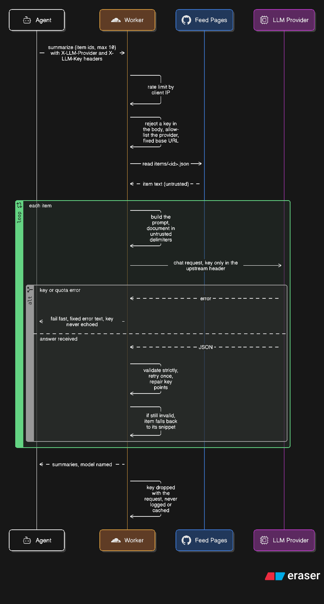
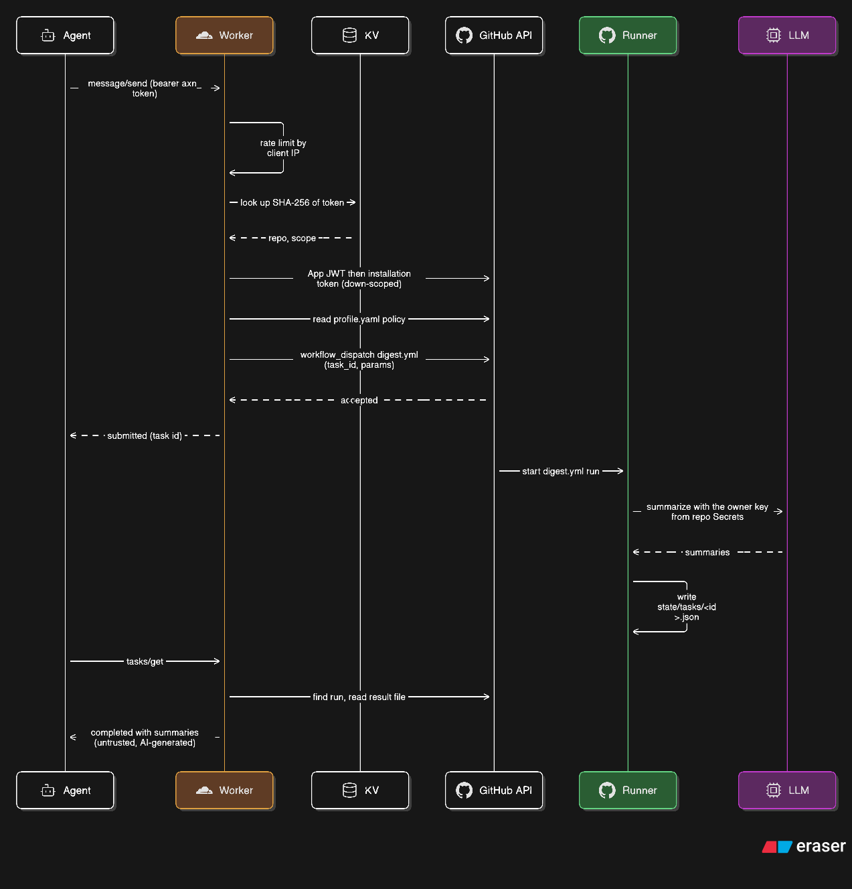
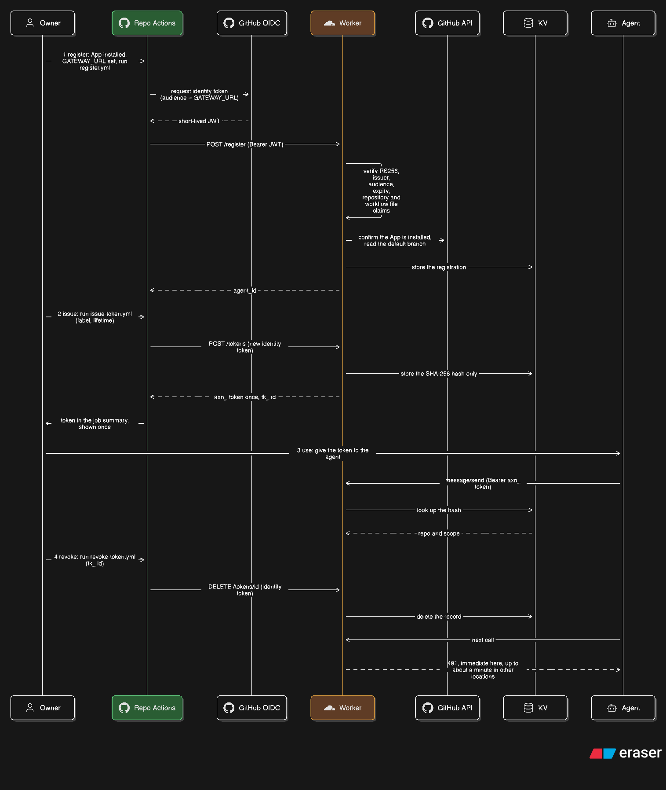
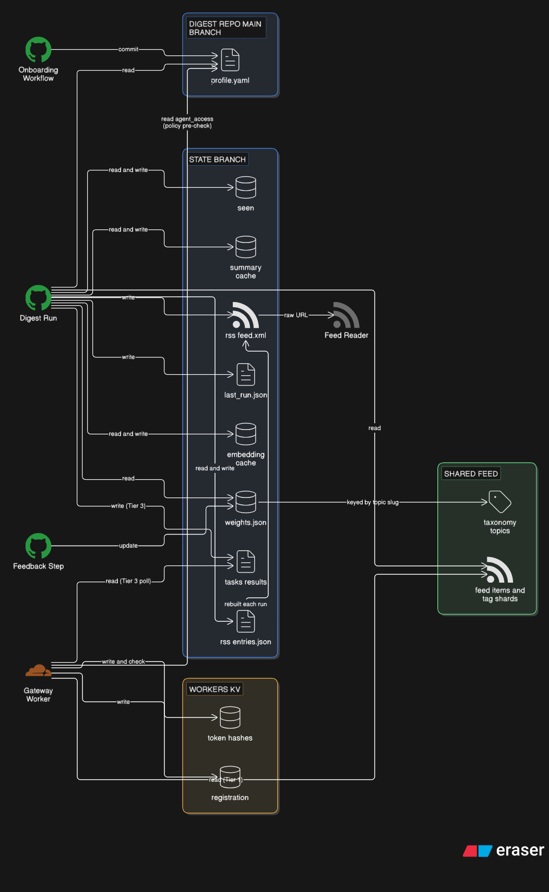

# axon-gateway architecture

`axon-gateway` is **plane 3** of [Axon](https://github.com/gowthamsai09/Axon): a Cloudflare Worker
(TypeScript, Hono, zod, jose) that exposes Axon to other agents over **A2A** and **MCP**. Both protocols
are thin adapters over **one core contract**, so a behaviour is implemented once.

Spec sections: 4.3, 7, 8 and 9, plus Appendix C items 45 to 75 and 115 to 127. Where this file and the
spec differ, the spec wins.

- **Live URL:** `https://axon-gateway.gowthamsaiyadlapalli1234.workers.dev`
- **Agent Card:** `/.well-known/agent-card.json`
- **Endpoints:** `POST /a2a`, `POST /mcp`, `GET /healthz`, `POST /register`, `POST /tokens`, `DELETE /tokens/:id`


## Layout

```
src/
  index.ts        routes, 405/404, no CORS
  a2a.ts          A2A 0.3.0 adapter           mcp.ts   MCP adapter (2026-07-28 and 2025-11-25)
  agentcard.ts    the Agent Card
  core/           the one contract:  updates.ts  summarize.ts  digest.ts  feed.ts  deps.ts
  providers.ts    fixed provider URLs; the key lives in a private field; redirect: "manual"
  summarizer/     prompting, validation, llm  (port of the template)
  prompts/        summarizer.generated.ts, generated from prompts/summarizer_system.txt
  tier3.ts  register.ts  tokens.ts           Tier 3 and identity
  github/         http, app (JWT + installation tokens), oidc (jose), runs (dispatch, list, read, cancel)
  budget.ts       45-subrequest budget and a concurrency pool
  ratelimit.ts  security.ts  env.ts  errors.ts  http.ts  util.ts  schemas.ts
```

`createApp(deps)` takes injected `fetch`, clock, sleep, random and nonce functions, which is what makes
every outbound call testable without a network.

## Tier 1: data (no key)

Reads the feed's `tags/<topic>.json` and `entities/<slug>.json` shards (or `latest.json`), merges, filters,
sorts and returns items without excerpts plus freshness metadata (`feed_generated_at`, `feed_stale` after
30 hours, `fallback`, `missing_shards`). Feed reads use `fetch` with Cloudflare edge caching (about
5 minutes) rather than the Cache API, because Cache API calls would count against the subrequest quota.
Only public feed URLs are fetched this way.

Topics and entities are validated slugs, because they become shard file names.

## Tier 2: summary with the caller's key



1. Parse headers: `X-LLM-Provider` (`deepseek` or `huggingface`), `X-LLM-Key`, optional `X-LLM-Model`.
2. **Refuse a key in the body** (key-like field names or key-shaped values) before anything else.
3. Read each `items/<id>.json` from the feed (at most 10 ids).
4. Build the same prompt as the template (version `p-56a22986b1`), call the provider from a **fixed base
   URL** (`https://api.deepseek.com` or `https://router.huggingface.co/v1`), validate the result strictly,
   retry once, repair key points, and degrade a single item to `not_summarized` rather than fail the request.
5. Return results, model, prompt version, usage and `untrusted: true`.

Behaviour on failure: a provider 401 or 403 (`llm_key_invalid`) or 402 (`llm_quota`) stops the request and
starts no new items. After two transient failures the rest are skipped and the request succeeds with the
partial results, or fails with `upstream_unavailable` if nothing was summarised. At most 3 items run at a
time inside a 45-subrequest budget. Observed cost: 10 items = 20 subrequests.

**The key:** held in a private field of the provider client, used for that request, then gone. Never in a
URL, a log, a cache, KV or a response. If the model's raw output contains the key, the item is treated as
invalid output (a guard found by a security test). Cloudflare Workers observability is disabled
(`[observability] enabled = false`), and the edge request log was checked: metadata only, no headers or bodies.

## Tier 3: the owner's digest (async)



1. **Authenticate** the `Authorization: Bearer axn_...` token: SHA-256 it, look up `tok:<hash>` in KV.
   Unknown, malformed, expired and revoked tokens all give the identical `auth_required` answer. This
   runs before the task id is even looked at, so nothing can be probed without a token.
2. **Rate limit** per token id (30 per 60 s), then the public per-IP limit as well.
3. **Policy pre-check:** read only the `agent_access` block of the owner's `profile.yaml` (default branch,
   at most 64 KiB, parsed with the `yaml` package with aliases disabled). Refuse if `allow_inbound_agents`
   is false or `digest` is missing from `allowed_modes`. The daily cap is checked by the pipeline, not here.
4. **Mint a GitHub App installation token** scoped to the one repo with `actions: write`, `contents: read`,
   `metadata: read`. Cached in isolate memory only, never in KV.
5. **Dispatch** `digest.yml` with inputs `{task_id, params}`. The task id is a UUIDv7 (it carries its creation time).
   `params` is built only from validated values.
6. Return a `submitted` Task. **Poll** with `tasks/get`: the gateway lists recent `workflow_dispatch` runs and
   matches the display title `digest task <id>`, then maps GitHub's run state to a task state and, once finished, reads
   `state:tasks/<id>.json` and validates it with a strict schema.

State mapping:

| GitHub run | Task state |
|---|---|
| queued, waiting, requested, pending | `submitted` |
| in progress | `working` |
| completed, result `completed` | `completed` |
| completed, result `failed` with `owner_policy:` warning | `rejected` |
| completed, any other failure, timeout or invalid result file | `failed` |
| cancelled | `canceled` |

A task not yet listed stays `submitted` for 2 minutes, then `TaskNotFound` (-32001). Results are kept 7 days.
`tasks/cancel` works while the run is queued or in progress; otherwise -32002.

The design is **stateless**: no database holds task state. The gateway reads GitHub and the owner's `state`
branch each time, so there is nothing to keep consistent or leak.

## Registration and tokens



| Step | What happens |
|---|---|
| Install | Owner installs the GitHub App on one repo and sets `GATEWAY_URL` |
| `register.yml` | Gets an OIDC token (audience = `GATEWAY_URL`) and calls `POST /register` |
| Verify | Worker checks RS256 signature, issuer, audience, expiry (`maxTokenAge` 15 minutes) and claims: `repository`, `repository_id` (digits), `repository_owner` matches, `event_name` is `workflow_dispatch`, and `job_workflow_ref` points at the expected workflow file in the **same** repo |
| Confirm | Calls `GET /repos/{repo}/installation` to prove the App is installed, then writes `repo:<owner/name>` to KV |
| `issue-token.yml` | Same OIDC proof; the Worker creates `axn_` + 32 random bytes, stores `tok:<sha256>` and `tokid:<repo>:<id>`, and returns the token once |
| Limits | Label 1 to 64 characters, lifetime 1 to 365 days (default 90), at most 10 active tokens per repo |
| `revoke-token.yml` | Deletes both KV keys. Immediate in the handling location; other locations may serve a stale read for about 60 seconds (documented KV propagation, from third-party summaries) |

The repository a token belongs to comes only from the verified OIDC claims. An `agent_id` is
`ag_` + 16 hex of sha256(`repository:<repository_id>`), stable across renames.

## Storage



| Where | What | Writes |
|---|---|---|
| KV `TOKENS` | `repo:`, `tok:`, `tokid:` records | Only on register, issue and revoke |
| Worker secret `GITHUB_APP_PRIVATE_KEY` | App key (PKCS#1 or PKCS#8, imported as a non-extractable CryptoKey) | Set once, type **Secret** |
| Worker vars | `PUBLIC_URL`, `FEED_BASE`, `GITHUB_APP_ID`, default model | In `wrangler.toml` |
| Isolate memory | Installation tokens, in-isolate rate-limit fallback | Lost on eviction |

Tier 3 appears only when the KV binding, a numeric `GITHUB_APP_ID` and the App key all exist. Otherwise the
Agent Card, `tools/list` and the stable 501 routes behave exactly as in Phase 3.

## Protocol adapters

**A2A 0.3.0.** `message/send` needs `role: "user"` and a `data` part `{skill, ...params}` (no natural-language
intent parsing: that would need an LLM on the owner's key). Tier 1 and 2 return a `completed` Task with one
`data` artifact. Not supported: streaming, resubscribe, push, the extended card. A2A v1.0 has shipped and is a
breaking redesign; migrating is a recorded open item.

**MCP.** Revision 2026-07-28 is primary: stateless, `server/discover`, the version in
`_meta["io.modelcontextprotocol/protocolVersion"]` and the `MCP-Protocol-Version`, `Mcp-Method` and
`Mcp-Name` headers (mismatches are -32020, HTTP 400; unsupported versions -32022). Revision 2025-11-25 is
served to older clients: `initialize` answers without a session id. Tools: `get_ai_updates`,
`summarize_items`, and (Tier 3 only) `start_digest`, `get_digest_status`. Tool failures are results with
`isError: true`. Authorisation is a static owner bearer token, not OAuth.

## HTTP rules and security

- POST only on `/a2a` and `/mcp`; GET only on the card and `/healthz`; others get 405 with `Allow`.
- Content type must be `application/json` (415); body at most 16 KB (413); JSON-RPC batches rejected.
- **No CORS headers.** Agents call server to server; a browser page must not be able to send a key
  through the Worker.
- `Cache-Control: no-store` everywhere except the card; `nosniff`; `Referrer-Policy: no-referrer`.
- Rate limits per client IP using Cloudflare `[[ratelimits]]` bindings: 60 per 60 s public, 10 per 60 s
  Tier 2, 30 per 60 s Tier 3 (per token). Counters are per location and approximate. A throwing or missing binding
  falls back to an in-isolate counter with the same limits, not to unlimited.
- `redirect: "manual"` on every outbound call (workerd does not implement `"error"`); a test scans `src/`.
- Dev-only GitHub overrides are honoured only when `ENVIRONMENT` is exactly `development`; `wrangler.toml`
  must never contain them (tested).
- Unexpected exceptions become a generic `internal_error` with no detail; nothing is logged.

## Build, test and deploy

```powershell
npm ci
npm run lint; npm run typecheck; npm test
npm run prompt:check          # generated prompt module equals the canonical prompt (p-56a22986b1)
npm run bench                 # Tier 1 timing in Node (not workerd)
```

Observed: **992 tests passed** (2026-11-28). CI runs lint, typecheck, tests, `prompt:check`, the hub
contract tests and `wrangler deploy --dry-run`.

`deploy.yml` runs after CI on `main`, inside the GitHub environment `production` with a required reviewer.
`scripts/check-deploy-config.js` refuses placeholder URLs, a bad KV id, dev override variables or enabled
observability. Cloudflare credentials are secrets of that environment only. Live deploy (observed): upload
1166 KiB (216 KiB gzip) against a 3 MB compressed limit, startup 23 ms.

## Verified live and not

| | State |
|---|---|
| Deploy, `/healthz`, Agent Card, A2A Tier 1, MCP `server/discover`, legacy `tools/list` and `tools/call` | **Verified live** |
| Tier 2 with a real DeepSeek key (2 items `ok`, key not echoed) | **Verified live** |
| Rate limit (70 POSTs: 61 `200`, 9 `429`) | **Verified live**; `Retry-After` not captured |
| Tier 3 over A2A: register, issue token, start, poll (`working` at about 16 s, `completed` at about 32 s), cancel, revoke then 401 | **Verified live** |
| Tier 3 over MCP; modern MCP `tools/call` with headers; a third-party A2A or MCP client | Not run |
| Per-request CPU p99, Tier 2 CPU and subrequests, KV use per Tier 3 request, revoke propagation delay | Not measured. Median CPU about 4.6 ms against a 10 ms free-plan limit |

## Free-plan limits to keep in mind

Recorded in the spec (Appendix B item 47, 2026-10-25): 100,000 requests per day, 10 ms CPU, 50 subrequests per
request, 3 MB compressed bundle, KV 100,000 reads and 1,000 writes per day. These come from a dated search
and third-party summaries, not a fresh check. Verify against Cloudflare's documentation before quoting them externally.
